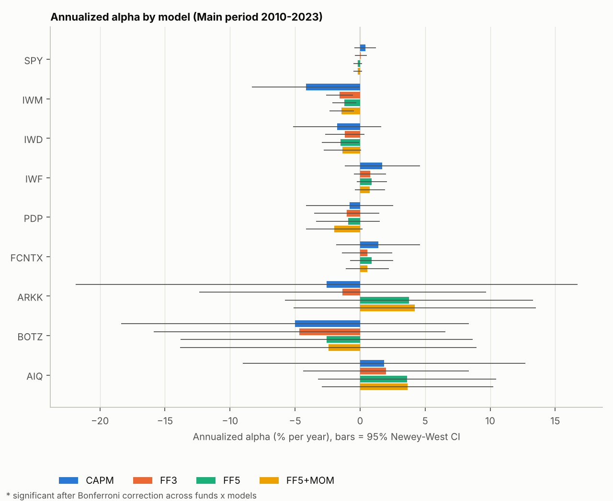
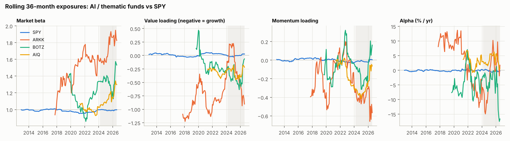

# Is it skill, or just style? Testing fund performance with Fama-French factor models

_Based on my MS Quantitative Finance Empirical Methods coursework (2024); rebuilt and extended in Python in 2026._

## The short version

### The question

Fund managers often claim to beat the market. But a fund can outperform simply by holding certain *kinds* of stocks, such as smaller companies, fast-growing companies or recent winners, that have historically earned higher returns. Anyone can get those same exposures through low-fee index funds, so they are not evidence of skill. The return left over after accounting for them is called **alpha**, and it is the only part that could reflect genuine skill.

### Why I tested it

Before paying a manager for performance, investors and allocators need to know whether they are paying for skill or for exposures they could buy through an index fund for a fraction of the fee. Factor regressions are the standard test investment teams use to tell the two apart, and the question has become more pressing with the rise of artificial-intelligence-themed funds, whose strong recent returns are often presented as a sign of insight.

### How I tested it

I took 9 well-known funds: broad index funds, an actively managed fund and three funds themed on artificial intelligence and innovation. For each one, I measured how much of its monthly return from 2010 to 2026 is explained by well-documented return drivers, called **factors** (the overall market, company size, value versus growth, profitability, investment and momentum), and how much is left over. I then checked whether any leftover return is statistically reliable once you account for testing many funds at once, and whether the picture changed after 2024.

### What I found

No fund shows positive alpha that holds up statistically. Under the strictest test (correcting across all 72 statistical tests at once), none survives. The one result that does hold up under a narrower, still standard test is *negative*: the Russell 2000 small-company fund returned about 1.4% a year less than its factor exposures predict. Where a fund appeared to beat the market, most of that edge disappeared once its tilts toward growth stocks and particular company types were taken into account. The artificial-intelligence funds' returns after 2024 came mainly from moving more sharply with the overall market, not from skill.



_Each fund's alpha under four models, from the market alone (blue) to all six factors (yellow). Bars crossing zero mean the alpha is not statistically distinguishable from zero._



_Factor loadings re-estimated over a moving 36-month window; the shaded area marks windows ending after March 2024. ARKK's and BOTZ's market betas climb toward 1.6-1.9, while the artificial-intelligence funds' momentum loadings stay near or below zero._

The code is a tested Python package: 11 automated tests on simulated data run on every push.

## Original (2024) versus rebuild (2026)

| Part | 2024 coursework | 2026 rebuild |
|---|---|---|
| Language | Python | Python |
| Capital Asset Pricing Model, three-factor and five-factor models | Yes | Rebuilt |
| Momentum factor (six-factor model) | — | New |
| Same 9 funds, January 2010 to December 2023 | Yes | Rebuilt |
| Newey-West standard errors, with 3, 6 and 12 lags | Yes | Rebuilt |
| Rolling 36-month regressions | Yes | Rebuilt |
| Bonferroni multiple-testing correction | Yes | Rebuilt |
| Holm and Benjamini-Hochberg corrections | — | New |
| Short-sample guard on standard errors | — | New |
| Post-2024 extension and formal test for changed exposures | — | New |
| Written fund summaries generated by a large language model | — | New |
| Automated tests on simulated data, run on every push | — | New |
| Reusable package with cached data and a single command to run | — | New |

## What I tested

The fund returns are monthly total returns (dividends reinvested). Each is regressed, after subtracting the risk-free rate, on four nested models:

| Model | Full name | Factors |
|---|---|---|
| CAPM | Capital Asset Pricing Model | Market (Mkt-RF) |
| FF3 | Fama-French three-factor model | + Size (SMB), Value (HML) |
| FF5 | Fama-French five-factor model | + Profitability (RMW), Investment (CMA) |
| FF5+MOM | Five-factor model plus momentum | + Momentum (MOM) |

### The funds

| Ticker | Fund | Role | Main-period sample |
|---|---|---|---|
| SPY | SPDR S&P 500 ETF Trust | Sanity check (beta ≈ 1, alpha ≈ 0) | Jan 2010 to Dec 2023 |
| IWM | iShares Russell 2000 ETF | Small companies | Jan 2010 to Dec 2023 |
| IWD | iShares Russell 1000 Value ETF | Value stocks | Jan 2010 to Dec 2023 |
| IWF | iShares Russell 1000 Growth ETF | Growth stocks | Jan 2010 to Dec 2023 |
| PDP | Invesco Dorsey Wright Momentum ETF | Momentum | Jan 2010 to Dec 2023 |
| FCNTX | Fidelity Contrafund | Actively managed, long history | Jan 2010 to Dec 2023 |
| ARKK | ARK Innovation ETF | Actively managed, innovation theme | Nov 2014 to Dec 2023 |
| BOTZ | Global X Robotics & Artificial Intelligence ETF | Robotics and artificial-intelligence theme | Oct 2016 to Dec 2023 |
| AIQ | Global X Artificial Intelligence & Technology ETF | Artificial-intelligence theme | Jun 2018 to Dec 2023 |

ETF stands for exchange-traded fund. PDP is used for momentum rather than the iShares MSCI USA Momentum Factor ETF (MTUM) because MTUM launched in 2013 and would not cover the full 2010 sample. Younger funds start at their **first full month** of returns, worked out from the price history (the partial launch month is excluded), and must have at least 60 months. The fund list lives in [`ff_alpha/config.py`](ff_alpha/config.py).

## Results

All figures use Kenneth French factor data through August 2026 and are annualized. Full tables are in [`results/summary.md`](results/summary.md). Terms are defined in the [glossary](#glossary).

1. **No fund earns positive alpha that survives correction for multiple testing.** Correcting across all 72 statistical tests of alpha (9 funds × 4 models × 2 periods), none is significant. With a narrower family, one model at a time, only IWM's *negative* alpha passes (see [below](#how-the-verdict-depends-on-what-counts-as-the-family-of-tests)).
2. **Where alpha looked positive against the market alone, adding factors shrinks it.** Neither of these market-only alphas was statistically significant to begin with.

   | Fund | Alpha vs market only | Alpha after six factors | Main tilts (loadings) |
   |---|---|---|---|
   | iShares Russell 1000 Growth (IWF) | +1.71% | +0.75% | Value −0.21, investment −0.14 |
   | Fidelity Contrafund (FCNTX) | +1.38% | +0.55% | Investment −0.24, value −0.12 |

3. **The factors explain almost everything for broad index funds.** The six-factor model explains 97-100% of the monthly return variation (R²) for the S&P 500, Russell 2000, value and growth funds, against 78-91% for the thematic funds.
4. **The strongest result is negative.** The Russell 2000 small-company fund (IWM) returned about 1.4% a year *less* than its six-factor exposures predict (t-statistic ≈ −3.0). Whether that counts as significant depends on how the tests are grouped, which is set out below.
5. **ARK Innovation (ARKK) is mostly a bundle of factor bets.** It moves about 1.55 times as much as the market, tilts strongly toward growth stocks (value loading −0.64) and leans heavily toward unprofitable companies (profitability loading −1.20).
6. **The sanity check passes.** The S&P 500 fund (SPY) should behave exactly like the market: its beta is 0.96-1.00 and its alpha under 0.5% a year in both periods. Its small negative size loading (−0.12) is expected, because the French market factor also includes small companies.

### Do the results hold up under other settings?

| Setting (correcting across all 36 tests per period) | Significant alphas (of 72 statistical tests) |
|---|---|
| Newey-West 3 lags, Bonferroni | 0 |
| Newey-West 6 lags (default), Bonferroni | 0 |
| Newey-West 12 lags, Bonferroni | 0 |
| Newey-West 6 lags, Holm | 0 |
| Newey-West 6 lags, Benjamini-Hochberg (looser) | 0 |
| Newey-West 6 lags, **no correction** | 7 |

The closest call is IWM's three-factor alpha, with adjusted p-values of 0.10 under both Bonferroni and Holm (for the single smallest p-value, Holm is identical to Bonferroni). Benjamini-Hochberg gives 0.065, but it controls the false discovery rate, the expected share of false positives among results called significant, a deliberately looser standard. It is reported as a check that the verdict does not depend on Bonferroni's strictness, not as evidence that IWM nearly passed. Without any correction, 7 tests look significant, which shows how easily testing many funds produces false positives.

### How the verdict depends on what counts as the family of tests

The table above corrects across all 36 fund-and-model tests in each period. That is conservative: the four models for one fund are nested and highly correlated, so they are not 4 independent chances of a false positive. The usual alternative is to treat one model as the primary test and correct only across the 9 funds. Doing that for each model in turn (main period, Holm correction across 9 funds):

| Model treated as primary | IWM alpha | Adjusted p, 3 / 6 / 12 lags | Significant? |
|---|---|---|---|
| Market only (CAPM) | −4.16% | 0.44 / 0.45 / 0.16 | No |
| Three-factor (FF3) | −1.59% | 0.019 / 0.026 / 0.052 | Yes, except at 12 lags |
| Five-factor (FF5) | −1.21% | 0.097 / 0.096 / 0.129 | No |
| Six-factor (FF5+MOM) | −1.42% | 0.028 / 0.033 / 0.049 | Yes, at all three lag settings |

IWM is the only fund significant in any of these families, and no fund is significant in the post-2024 extension under any of them.

**How to read this.** The six-factor model is the natural primary specification: it is the most complete model, and it was fixed in the code as the model for the rolling and change tests from the first commit. Under it, IWM's underperformance is significant after correcting across the 9 funds. But the result is not robust to every reasonable choice: under the five-factor model it is not significant, because the profitability and investment factors absorb part of the shortfall, and at 12 lags the six-factor result only just clears the bar (0.049). The fair summary is **moderate evidence that IWM underperformed its factor exposures, and no evidence of positive skill in any fund.**

## What the results say

- **Most apparent alpha is factor exposure.** Alpha measured against the market alone rewards a fund for any tilt toward small, value, profitable or recently winning stocks, simply because those tilts have earned premiums. Adding the factors re-labels that return as exposure, which investors can get through low-fee index funds. IWF's market-only alpha falls from +1.7% to +0.75% and Contrafund's from +1.4% to +0.55%. Neither was significant to begin with, which is the more honest point: the apparent outperformance was never reliable, and most of it is factor tilts.
- **R² shows how much is left to explain.** Broad index funds have R² of 0.97-1.00 in the six-factor model, so little room remains for skill. Thematic and actively managed funds have lower R², so fund-specific bets drive more of their returns, in either direction.
- **Statistical significance needs care.** Monthly returns are correlated over time (Newey-West), many funds are tested at once (multiple-testing corrections), and short samples can make Newey-West standard errors misleadingly small (the short-sample guard).
- **Exposures change over time.** The rolling regressions show that loadings are not constant: a fund's style in one period can differ sharply from another, which matters for risk management and for judging a manager.

### Why does IWM lag its factors?

IWM's −1.4% a year is the result that most needs explaining. These are candidate explanations, not tested in this project:

- **Index rebuild costs.** The Russell 2000 is rebuilt once a year on a published schedule, so traders can buy the stocks about to be added and sell the ones about to be dropped before index funds are forced to trade. Cai and Houge (*Financial Analysts Journal*, 2008) found that over 1979-2004, a buy-and-hold version of the index beat the annually rebuilt one by 2.2% in the following year. More recent work suggests this cost has shrunk as markets became more liquid, so it probably explains part of the gap, not all of it.
- **The index holds the stocks the five-factor model prices worst.** Fama and French (2015) note that their model's biggest failure is small companies that invest heavily despite low profitability, which earn less than the model predicts. The Russell 2000 holds many of these, and a single profitability loading (−0.10 here) does not fully capture them.
- **The size factor is built differently from the index.** The size factor averages equally across value and profitability groups and uses New York Stock Exchange size cut-offs, while the Russell 2000 weights companies by market value and uses its own cut-offs. A size loading of 0.83 is a close but imperfect stand-in for what IWM actually holds.
- **Fees are not the answer.** IWM's annual fee of about 0.2% is far too small to explain a 1.4% gap.

## Does it still hold? 2024–2026

The main period covers January 2010 to December 2023 (168 months for established funds). The extension runs from March 2024 to August 2026, the latest month in the French library (30 months). January and February 2024 are left out of both periods, as set in the original study design, to keep a clean break between them. Starting the extension in January 2024 instead (32 months) changes nothing material: still no significant alpha in any of the 36 tests, and six-factor market betas move by at most 0.01 (see [`results/summary.md`](results/summary.md)). It asks: **did the artificial-intelligence funds' alpha and exposures persist, or were their returns mostly market, growth and momentum exposure?**

The [rolling-exposure chart](#what-i-found) in the short version shows these shifts over time.

- **The artificial-intelligence funds' recent returns came mainly from higher market exposure, not momentum.** The Global X Artificial Intelligence & Technology fund's (AIQ) market beta rose from 1.06 to 1.39, and the Global X Robotics & Artificial Intelligence fund's (BOTZ) from 1.24 to 1.41. Their momentum loadings barely changed (BOTZ +0.28, t = 1.7; AIQ +0.14, t = 0.9).
- **No new alpha appeared.** BOTZ shows −16% a year of six-factor alpha after 2024 (t = −2.0 under the short-sample guard), but it is not significant after correction over only 30 months.
- **Exposures do change over time.** A joint test of whether any loading changed after 2024 rejects "no change" at the 5% level for 7 of 9 funds before correction. Correcting across the 9 funds, that becomes 6 under Holm (SPY drops out, p = 0.017) and 5 under Bonferroni (AIQ also drops out, p = 0.008, against a threshold of 0.05 / 9 ≈ 0.0056). ARKK (p = 0.09) and BOTZ (p = 0.18) are not significant even before correction, partly because their samples are short and noisy.

The post-2024 data is used to re-test the findings, not to re-tune the model. With only 30 months, treat these results as indicative.

## How it works

**Data.** Monthly total returns come from Yahoo Finance via `yfinance`. Factors and the risk-free rate come from the [Kenneth French data library](https://mba.tuck.dartmouth.edu/pages/faculty/ken.french/data_library.html) via `pandas-datareader`, with a direct-download fallback. Excess returns subtract the **French risk-free column (RF)**, the same one-month Treasury bill series used to build the market factor, so fund and market excess returns are measured consistently.

**Regression.** For each fund, ordinary least squares (OLS) estimates

```math
R_{t} - RF_{t} = \alpha + \beta_{M}(Mkt_{t} - RF_{t}) + \beta_{S}SMB_{t} + \beta_{H}HML_{t} + \beta_{R}RMW_{t} + \beta_{C}CMA_{t} + \beta_{U}MOM_{t} + \varepsilon_{t}
```

with smaller models dropping terms from the right. Alpha is reported annualized (monthly × 12).

**Standard errors.** Monthly fund returns are correlated over time and their volatility changes, both of which make ordinary standard errors too small. I use Newey-West standard errors (also called HAC: heteroskedasticity and autocorrelation consistent) with 6 lags by default, and re-run every table with 3 and 12 lags, flagging any fund whose verdict changes. p-values use the t-distribution.

**Multiple testing.** With 9 funds × 4 models = 36 alpha tests per period, about two would look "significant" at the 5% level by luck alone. Three corrections are reported side by side:

| Method | Controls | Strictness |
|---|---|---|
| Bonferroni | Chance of *any* false positive | Strictest: `p × 36 < 0.05` |
| Holm | Same as Bonferroni | Step-down version: never less powerful, identical for the smallest p-value |
| Benjamini-Hochberg | Expected *share* of false positives (false discovery rate) | Looser: checks that conclusions don't depend on Bonferroni's strictness |

Each is applied to two families of tests: all 36 fund-and-model tests in a period (the strict headline), and the 9 funds within one model (the usual primary-model test). The joint tests of changed exposures after 2024 are corrected across the 9 funds in the same way.

**Short-sample guard.** In samples under 60 months (the post-2024 extension), the Newey-West estimator can pick up spurious negative correlation and produce standard errors *smaller* than plain OLS. On simulated data with zero true alpha, this produced a t-statistic of 3.9 from 29 months (plain OLS: 1.85). Below 60 months, standard errors are therefore never allowed to fall below the OLS value; the unadjusted Newey-West t-statistic is kept in `regressions.csv` as `alpha_t_nw_raw`. In the extension the guard binds for most estimates (27 of the 36 fund-and-model pairs), so many extension t-statistics are identical across 3, 6 and 12 lags in the robustness tables. That is expected, not a bug.

**Rolling exposures.** The six-factor model is re-estimated over every 36-month window for each fund, from 2010 (or the fund's launch) through the latest factor month. These are point estimates only, because overlapping windows are not independent tests.

**Testing for changed exposures.** Both periods are pooled, with an indicator $POST_t$ equal to 1 from March 2024:

```math
y_{t} = \alpha + \beta' f_{t} + \delta \cdot POST_{t} + \gamma' (f_{t} \cdot POST_{t}) + \varepsilon_{t}
```

$\delta$ is the change in alpha, each element of $\gamma$ the change in a loading, and a joint Wald test checks whether any loading changed.

**Written fund summaries.** [`ff_alpha/explain.py`](ff_alpha/explain.py) sends each fund's computed numbers (as JSON) to a large language model (LLM) with instructions to use only those numbers, explain the two or three exposures that matter in everyday terms, and use the corrected significance results as the verdict. It uses the same Claude Code setup as my [LLM earnings-signal project](https://github.com/pooja003-cloud/llm-earnings-signal), so no paid API key is needed:

| Option | What you need | Cost |
|---|---|---|
| `--llm claude_code` | [Claude Code](https://code.claude.com), signed in with a Claude Pro or Max subscription | Included in the subscription; uses its normal usage limits |
| `--llm anthropic` | A key for Anthropic's paid programming interface (`ANTHROPIC_API_KEY`) | Pay per use (optional, not needed) |
| `--llm template` (default) | Nothing | Free; a fixed template, no language model |

Two safeguards make the summaries trustworthy:

- **Every number is checked.** Each number in the model's text is compared with the computed results (allowing only rounding). A summary with a number that isn't in the data is sent back once with the problem listed; if it fails again, the fixed template is used instead. The outcome for each fund is saved in `results/explanations_check.json`.
- **No accidental API billing.** With `claude_code`, `ANTHROPIC_API_KEY` is removed from Claude Code's environment, so the call can only use the subscription.

**Sample output (ARKK)**, written by Claude Sonnet 5.5 through Claude Code with `python run.py --llm claude_code`. It is copied unedited from [`results/explanations.md`](results/explanations.md), which has all nine funds:

> ARK Innovation ETF, an actively managed fund, shows no statistically reliable alpha, meaning no return beyond what its exposure to common market drivers (called factors) would predict. This holds in all four models for 2014-2023, even after correcting for the many tests run. Using only the market as a yardstick, the fund looked like it lagged by about 2.6% a year. In the richer models the sign flipped to roughly 3.8% to 4.2% a year. Neither figure is distinguishable from zero, so the apparent weakness mostly reflected factor exposure rather than manager skill or its absence.
>
> Three exposures matter most. First, the fund amplifies market swings, with a market beta (sensitivity) of about 1.5 to 1.7. Second, it behaves like a bet on small companies. Third, it leans toward growth stocks, which are priced high relative to their accounting value, and toward firms with weak profitability.
>
> After 2024, the alpha estimate barely changed, and that change was statistically negligible. The factor loadings did not change significantly after correction, though the 30-month sample is short, so this comparison is uncertain.

The number check confirms that every figure comes from the results; it cannot confirm that each figure is described correctly, so the summaries were also read against `results/regressions.csv` before committing.

## Running it

```bash
git clone https://github.com/pooja003-cloud/fama-french-factor-regression.git
cd fama-french-factor-regression
python -m venv .venv && source .venv/bin/activate
pip install -r requirements.txt

python -m pytest -q                 # 11 automated tests, offline, on simulated data
python run.py --demo --no-llm       # whole pipeline on simulated data -> results_demo/
python run.py                       # real data -> results/
python run.py --refresh             # re-download factors and prices
python run.py --llm claude_code     # fund summaries via Claude Code (Pro plan, no API key)
```

Downloads are cached in `data/raw/`. The French library is revised occasionally, so note the download date when quoting numbers.

**Validation.** The test suite simulates factor returns and funds with **known** alphas and loadings (including a momentum shift after 2024 for the artificial-intelligence funds) and checks that the pipeline recovers them. It also checks that a fund built to match the market gives beta ≈ 1 and alpha ≈ 0, that a fund's partial launch month is excluded, that the Bonferroni, Holm and Benjamini-Hochberg adjustments are applied correctly, that the French data parser handles the file layout, and that the fund summaries' number check catches invented figures and never passes an API key to Claude Code. **11 automated tests run in continuous integration** (GitHub Actions), together with the full demo pipeline, on every push.

### Outputs

| File | Contents |
|---|---|
| `results/summary.md` | Sanity check, fund samples, alpha and loading tables, robustness checks, extension tests |
| `results/regressions.csv` | Every fund × model × period × lag: alpha, t-statistic, raw and corrected p-values, loadings, R² |
| `results/structural_change.csv` | Change in alpha and loadings after 2024 |
| `results/rolling_loadings.csv` | Rolling 36-month estimates |
| `results/explanations.md` | Written summary for each fund |
| `results/figures/` | Alpha by model, loadings heatmap, R², rolling charts |

## Code layout

```
ff_alpha/
  config.py    funds, periods, models, settings
  data.py      French factors, fund returns, synthetic data
  models.py    regressions, multiple-testing corrections, post-2024 change test
  rolling.py   rolling 36-month regressions
  report.py    tables and figures
  explain.py   LLM-written fund summaries (Claude Code, API or template) with a number check
run.py         runs the full study
tests/         offline tests on simulated data
```

## Limits and next steps

- **After fees.** Fund returns are net of fees, so alpha is what an investor actually received, not the manager's skill before costs.
- **Market factor scope.** The French market factor covers all stocks in the CRSP (Center for Research in Security Prices) database, including small companies, so SPY's alpha against it is not exactly zero; large-company outperformance shows up as a small alpha and a slightly negative size loading.
- **Survivorship bias.** The funds were chosen in 2026, knowing they still exist.
- **Data quality.** Yahoo Finance adjusted prices are convenient but not research-grade; CRSP mutual fund data would be the professional source.
- **Short extension.** The post-2024 sample is 30 months, so its tests have low power.
- **Next step: explain IWM.** Compare IWM with the S&P SmallCap 600 index, which is rebuilt differently and screens for profitability, to separate index-rebuild costs from the five-factor model's known weakness with small, unprofitable companies.

## Glossary

| Term | Meaning |
|---|---|
| Alpha | Return a fund earns beyond what its factor exposures explain; the part that could reflect skill. |
| Beta / loading | How strongly a fund's return moves with a factor. A market beta of 1.5 means the fund tends to move 1.5% when the market moves 1%. |
| Factor | A broad, well-documented source of return, such as the overall market, small versus large companies, or recent winners versus losers. |
| Size (SMB) | "Small minus big": returns of small companies minus large ones. |
| Value (HML) | "High minus low": companies priced low relative to their accounting value minus those priced high. A negative loading means a tilt toward growth stocks. |
| Profitability (RMW) | "Robust minus weak": highly profitable companies minus weakly profitable ones. |
| Investment (CMA) | "Conservative minus aggressive": companies that invest cautiously minus those expanding aggressively. |
| Momentum (MOM) | Stocks that rose most over the past year minus those that fell most. |
| Excess return | A fund's return minus the risk-free rate (one-month Treasury bills). |
| R² | Share of a fund's month-to-month return variation explained by the factors (0 to 1). |
| t-statistic | How many standard errors an estimate is from zero; roughly, above 2 or below −2 suggests it is not due to chance. |
| p-value | Probability of seeing a result at least this extreme if the true value were zero. |
| Newey-West standard errors | Standard errors adjusted for returns that are correlated over time and have changing volatility. |
| Multiple-testing correction | Raising the bar for significance when many tests are run, so that lucky results are not mistaken for real ones. |
