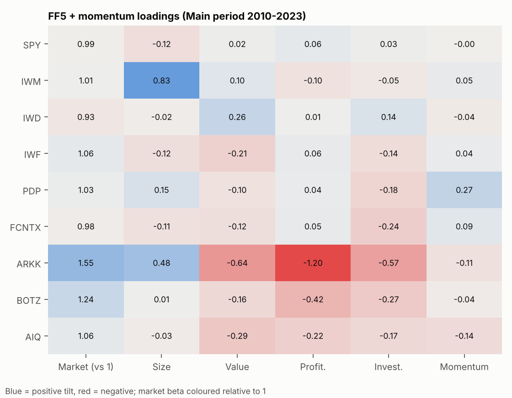
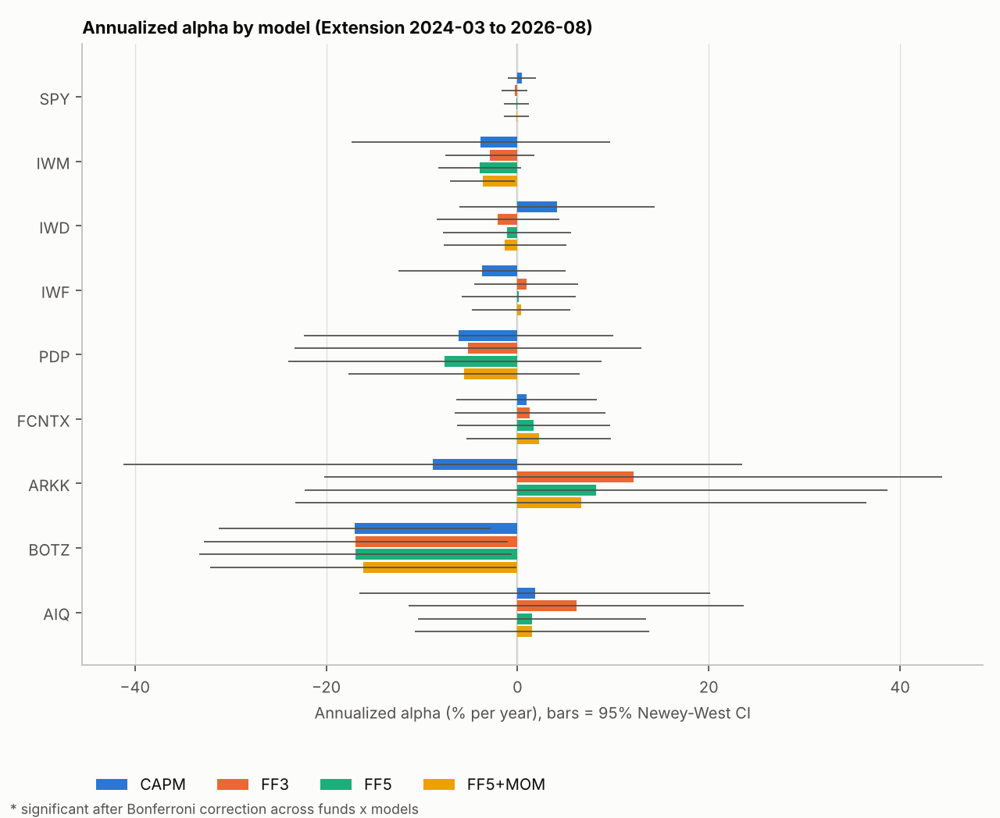
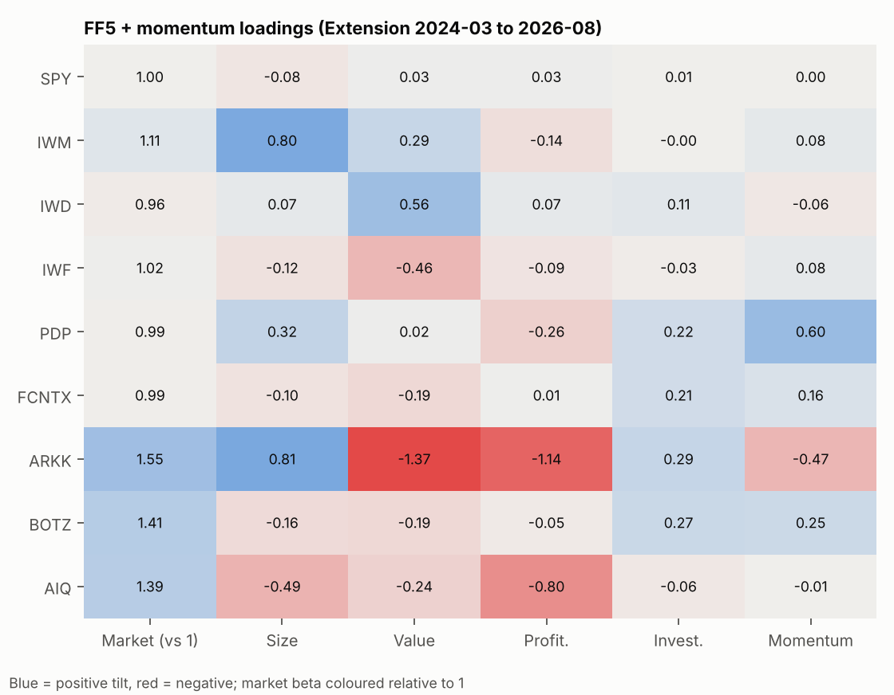

# Results

Factors: Ken French library, 1963-07 to 2026-08. Newey-West lags = 6 unless stated. Alpha in % per year (monthly x 12). Bonferroni: p x number of fund-model tests in the period.

## Sanity check

- Main period 2010-2023: SPY CAPM beta = 0.958, alpha = 0.39% / yr, R² = 0.990 -> PASS
- Extension 2024-03 to 2026-08: SPY CAPM beta = 0.970, alpha = 0.46% / yr, R² = 0.992 -> PASS

## Fund samples

| Fund | First full month | Original-period start |
|---|---|---|
| SPY | 2000-02 | 2010-01 |
| IWM | 2000-06 | 2010-01 |
| IWD | 2000-06 | 2010-01 |
| IWF | 2000-06 | 2010-01 |
| PDP | 2007-04 | 2010-01 |
| FCNTX | 2000-02 | 2010-01 |
| ARKK | 2014-11 | 2014-11 |
| BOTZ | 2016-10 | 2016-10 |
| AIQ | 2018-06 | 2018-06 |

## Main period 2010-2023

### Alpha by model

| Fund | Model | Alpha (% / yr) | t(alpha) | p | p (Bonferroni) | p (Holm) | p (BH) | Significant (Bonf.) | Mkt beta | R² | Months | Sample |
|---|---|---|---|---|---|---|---|---|---|---|---|---|
| SPY | CAPM | 0.39 | 0.91 | 0.362 | 1.000 | 1.000 | 0.646 | no | 0.96 | 0.99 | 168 | 2010-01 to 2023-12 |
| SPY | FF3 | 0.05 | 0.22 | 0.828 | 1.000 | 1.000 | 0.828 | no | 0.99 | 1.00 | 168 | 2010-01 to 2023-12 |
| SPY | FF5 | -0.18 | -1.07 | 0.286 | 1.000 | 1.000 | 0.631 | no | 0.99 | 1.00 | 168 | 2010-01 to 2023-12 |
| SPY | FF5+MOM | -0.17 | -1.01 | 0.315 | 1.000 | 1.000 | 0.631 | no | 0.99 | 1.00 | 168 | 2010-01 to 2023-12 |
| IWM | CAPM | -4.16 | -1.97 | 0.050 | 1.000 | 1.000 | 0.361 | no | 1.19 | 0.85 | 168 | 2010-01 to 2023-12 |
| IWM | FF3 | -1.59 | -3.02 | 0.003 | 0.104 | 0.104 | 0.065 | no | 1.00 | 0.99 | 168 | 2010-01 to 2023-12 |
| IWM | FF5 | -1.21 | -2.58 | 0.011 | 0.383 | 0.362 | 0.128 | no | 1.00 | 0.99 | 168 | 2010-01 to 2023-12 |
| IWM | FF5+MOM | -1.42 | -2.95 | 0.004 | 0.130 | 0.126 | 0.065 | no | 1.01 | 0.99 | 168 | 2010-01 to 2023-12 |
| IWD | CAPM | -1.77 | -1.03 | 0.306 | 1.000 | 1.000 | 0.631 | no | 0.94 | 0.91 | 168 | 2010-01 to 2023-12 |
| IWD | FF3 | -1.17 | -1.54 | 0.125 | 1.000 | 1.000 | 0.531 | no | 0.93 | 0.97 | 168 | 2010-01 to 2023-12 |
| IWD | FF5 | -1.52 | -2.07 | 0.040 | 1.000 | 1.000 | 0.361 | no | 0.93 | 0.97 | 168 | 2010-01 to 2023-12 |
| IWD | FF5+MOM | -1.36 | -1.85 | 0.066 | 1.000 | 1.000 | 0.395 | no | 0.93 | 0.97 | 168 | 2010-01 to 2023-12 |
| IWF | CAPM | 1.71 | 1.16 | 0.249 | 1.000 | 1.000 | 0.631 | no | 1.02 | 0.93 | 168 | 2010-01 to 2023-12 |
| IWF | FF3 | 0.76 | 1.22 | 0.223 | 1.000 | 1.000 | 0.631 | no | 1.06 | 0.98 | 168 | 2010-01 to 2023-12 |
| IWF | FF5 | 0.89 | 1.51 | 0.133 | 1.000 | 1.000 | 0.531 | no | 1.05 | 0.98 | 168 | 2010-01 to 2023-12 |
| IWF | FF5+MOM | 0.75 | 1.26 | 0.209 | 1.000 | 1.000 | 0.631 | no | 1.06 | 0.98 | 168 | 2010-01 to 2023-12 |
| PDP | CAPM | -0.81 | -0.48 | 0.635 | 1.000 | 1.000 | 0.760 | no | 0.99 | 0.86 | 168 | 2010-01 to 2023-12 |
| PDP | FF3 | -1.03 | -0.80 | 0.422 | 1.000 | 1.000 | 0.646 | no | 0.99 | 0.88 | 168 | 2010-01 to 2023-12 |
| PDP | FF5 | -0.94 | -0.75 | 0.456 | 1.000 | 1.000 | 0.646 | no | 0.99 | 0.88 | 168 | 2010-01 to 2023-12 |
| PDP | FF5+MOM | -1.97 | -1.78 | 0.077 | 1.000 | 1.000 | 0.395 | no | 1.03 | 0.92 | 168 | 2010-01 to 2023-12 |
| FCNTX | CAPM | 1.38 | 0.85 | 0.399 | 1.000 | 1.000 | 0.646 | no | 0.94 | 0.90 | 168 | 2010-01 to 2023-12 |
| FCNTX | FF3 | 0.54 | 0.55 | 0.582 | 1.000 | 1.000 | 0.723 | no | 0.98 | 0.95 | 168 | 2010-01 to 2023-12 |
| FCNTX | FF5 | 0.88 | 1.04 | 0.298 | 1.000 | 1.000 | 0.631 | no | 0.96 | 0.95 | 168 | 2010-01 to 2023-12 |
| FCNTX | FF5+MOM | 0.55 | 0.66 | 0.513 | 1.000 | 1.000 | 0.684 | no | 0.98 | 0.95 | 168 | 2010-01 to 2023-12 |
| ARKK | CAPM | -2.58 | -0.26 | 0.794 | 1.000 | 1.000 | 0.828 | no | 1.71 | 0.60 | 110 | 2014-11 to 2023-12 |
| ARKK | FF3 | -1.35 | -0.24 | 0.811 | 1.000 | 1.000 | 0.828 | no | 1.53 | 0.76 | 110 | 2014-11 to 2023-12 |
| ARKK | FF5 | 3.76 | 0.77 | 0.442 | 1.000 | 1.000 | 0.646 | no | 1.58 | 0.82 | 110 | 2014-11 to 2023-12 |
| ARKK | FF5+MOM | 4.20 | 0.88 | 0.378 | 1.000 | 1.000 | 0.646 | no | 1.55 | 0.82 | 110 | 2014-11 to 2023-12 |
| BOTZ | CAPM | -4.99 | -0.73 | 0.466 | 1.000 | 1.000 | 0.646 | no | 1.26 | 0.72 | 87 | 2016-10 to 2023-12 |
| BOTZ | FF3 | -4.65 | -0.81 | 0.418 | 1.000 | 1.000 | 0.646 | no | 1.23 | 0.76 | 87 | 2016-10 to 2023-12 |
| BOTZ | FF5 | -2.57 | -0.45 | 0.654 | 1.000 | 1.000 | 0.760 | no | 1.25 | 0.78 | 87 | 2016-10 to 2023-12 |
| BOTZ | FF5+MOM | -2.44 | -0.42 | 0.675 | 1.000 | 1.000 | 0.760 | no | 1.24 | 0.78 | 87 | 2016-10 to 2023-12 |
| AIQ | CAPM | 1.84 | 0.33 | 0.741 | 1.000 | 1.000 | 0.809 | no | 1.12 | 0.83 | 67 | 2018-06 to 2023-12 |
| AIQ | FF3 | 1.99 | 0.61 | 0.542 | 1.000 | 1.000 | 0.697 | no | 1.09 | 0.89 | 67 | 2018-06 to 2023-12 |
| AIQ | FF5 | 3.62 | 1.04 | 0.305 | 1.000 | 1.000 | 0.631 | no | 1.09 | 0.90 | 67 | 2018-06 to 2023-12 |
| AIQ | FF5+MOM | 3.64 | 1.08 | 0.284 | 1.000 | 1.000 | 0.631 | no | 1.06 | 0.91 | 67 | 2018-06 to 2023-12 |

### FF5 + momentum loadings, beta (t-stat)

| Fund | Alpha (% / yr) | Mkt-RF | SMB | HML | RMW | CMA | MOM | R² |
|---|---|---|---|---|---|---|---|---|
| SPY | -0.17 | 0.99 (143.2) | -0.12 (-15.7) | 0.02 (1.4) | 0.06 (3.1) | 0.03 (1.8) | -0.00 (-0.4) | 1.00 |
| IWM | -1.42 | 1.01 (96.9) | 0.83 (38.3) | 0.10 (4.7) | -0.10 (-4.2) | -0.05 (-2.5) | 0.05 (3.7) | 0.99 |
| IWD | -1.36 | 0.93 (56.2) | -0.02 (-0.9) | 0.26 (5.8) | 0.01 (0.4) | 0.14 (2.3) | -0.04 (-2.1) | 0.97 |
| IWF | 0.75 | 1.06 (78.2) | -0.12 (-5.1) | -0.21 (-9.4) | 0.06 (1.7) | -0.14 (-3.9) | 0.04 (2.1) | 0.98 |
| PDP | -1.97 | 1.03 (38.3) | 0.15 (2.9) | -0.10 (-2.1) | 0.04 (0.8) | -0.18 (-2.5) | 0.27 (6.3) | 0.92 |
| FCNTX | 0.55 | 0.98 (45.0) | -0.11 (-2.2) | -0.12 (-3.7) | 0.05 (1.0) | -0.24 (-4.4) | 0.09 (3.3) | 0.95 |
| ARKK | 4.20 | 1.55 (11.3) | 0.48 (2.6) | -0.64 (-2.9) | -1.20 (-4.0) | -0.57 (-1.6) | -0.11 (-0.9) | 0.82 |
| BOTZ | -2.44 | 1.24 (10.5) | 0.01 (0.1) | -0.16 (-1.0) | -0.42 (-2.0) | -0.27 (-1.1) | -0.04 (-0.2) | 0.78 |
| AIQ | 3.64 | 1.06 (21.2) | -0.03 (-0.2) | -0.29 (-3.0) | -0.22 (-1.5) | -0.17 (-0.9) | -0.14 (-1.5) | 0.91 |

### Robustness: alpha t-stat by Newey-West lag

| Fund | Model | t (lag 3) | t (lag 6) | t (lag 12) | Bonferroni verdict stable |
|---|---|---|---|---|---|
| AIQ | CAPM | 0.37 | 0.33 | 0.32 | yes |
| AIQ | FF3 | 0.66 | 0.61 | 0.64 | yes |
| AIQ | FF5 | 1.12 | 1.04 | 1.08 | yes |
| AIQ | FF5+MOM | 1.17 | 1.08 | 1.09 | yes |
| ARKK | CAPM | -0.30 | -0.26 | -0.23 | yes |
| ARKK | FF3 | -0.27 | -0.24 | -0.22 | yes |
| ARKK | FF5 | 0.83 | 0.77 | 0.80 | yes |
| ARKK | FF5+MOM | 0.94 | 0.88 | 0.92 | yes |
| BOTZ | CAPM | -0.79 | -0.73 | -0.74 | yes |
| BOTZ | FF3 | -0.86 | -0.81 | -0.88 | yes |
| BOTZ | FF5 | -0.46 | -0.45 | -0.49 | yes |
| BOTZ | FF5+MOM | -0.43 | -0.42 | -0.45 | yes |
| FCNTX | CAPM | 0.90 | 0.85 | 0.91 | yes |
| FCNTX | FF3 | 0.56 | 0.55 | 0.57 | yes |
| FCNTX | FF5 | 1.03 | 1.04 | 1.15 | yes |
| FCNTX | FF5+MOM | 0.64 | 0.66 | 0.75 | yes |
| IWD | CAPM | -1.11 | -1.03 | -1.02 | yes |
| IWD | FF3 | -1.62 | -1.54 | -1.57 | yes |
| IWD | FF5 | -2.15 | -2.07 | -2.15 | yes |
| IWD | FF5+MOM | -1.93 | -1.85 | -1.96 | yes |
| IWF | CAPM | 1.24 | 1.16 | 1.20 | yes |
| IWF | FF3 | 1.28 | 1.22 | 1.21 | yes |
| IWF | FF5 | 1.54 | 1.51 | 1.54 | yes |
| IWF | FF5+MOM | 1.29 | 1.26 | 1.30 | yes |
| IWM | CAPM | -1.98 | -1.97 | -2.41 | yes |
| IWM | FF3 | -3.12 | -3.02 | -2.80 | yes |
| IWM | FF5 | -2.58 | -2.58 | -2.48 | yes |
| IWM | FF5+MOM | -3.00 | -2.95 | -2.82 | yes |
| PDP | CAPM | -0.46 | -0.48 | -0.49 | yes |
| PDP | FF3 | -0.72 | -0.80 | -0.95 | yes |
| PDP | FF5 | -0.67 | -0.75 | -0.90 | yes |
| PDP | FF5+MOM | -1.64 | -1.78 | -1.91 | yes |
| SPY | CAPM | 0.97 | 0.91 | 0.95 | yes |
| SPY | FF3 | 0.21 | 0.22 | 0.23 | yes |
| SPY | FF5 | -0.92 | -1.07 | -1.27 | yes |
| SPY | FF5+MOM | -0.87 | -1.01 | -1.19 | yes |

## Extension 2024-03 to 2026-08

### Alpha by model

| Fund | Model | Alpha (% / yr) | t(alpha) | p | p (Bonferroni) | p (Holm) | p (BH) | Significant (Bonf.) | Mkt beta | R² | Months | Sample |
|---|---|---|---|---|---|---|---|---|---|---|---|---|
| SPY | CAPM | 0.46 | 0.62 | 0.542 | 1.000 | 1.000 | 0.899 | no | 0.97 | 0.99 | 30 | 2024-03 to 2026-08 |
| SPY | FF3 | -0.32 | -0.47 | 0.642 | 1.000 | 1.000 | 0.899 | no | 0.99 | 0.99 | 30 | 2024-03 to 2026-08 |
| SPY | FF5 | -0.14 | -0.21 | 0.832 | 1.000 | 1.000 | 0.899 | no | 1.00 | 1.00 | 30 | 2024-03 to 2026-08 |
| SPY | FF5+MOM | -0.13 | -0.19 | 0.849 | 1.000 | 1.000 | 0.899 | no | 1.00 | 1.00 | 30 | 2024-03 to 2026-08 |
| IWM | CAPM | -3.86 | -0.56 | 0.580 | 1.000 | 1.000 | 0.899 | no | 1.20 | 0.68 | 30 | 2024-03 to 2026-08 |
| IWM | FF3 | -2.89 | -1.23 | 0.231 | 1.000 | 1.000 | 0.899 | no | 1.16 | 0.97 | 30 | 2024-03 to 2026-08 |
| IWM | FF5 | -3.92 | -1.77 | 0.089 | 1.000 | 1.000 | 0.534 | no | 1.13 | 0.98 | 30 | 2024-03 to 2026-08 |
| IWM | FF5+MOM | -3.65 | -2.11 | 0.046 | 1.000 | 1.000 | 0.437 | no | 1.11 | 0.99 | 30 | 2024-03 to 2026-08 |
| IWD | CAPM | 4.15 | 0.80 | 0.432 | 1.000 | 1.000 | 0.899 | no | 0.73 | 0.58 | 30 | 2024-03 to 2026-08 |
| IWD | FF3 | -2.04 | -0.62 | 0.540 | 1.000 | 1.000 | 0.899 | no | 0.92 | 0.88 | 30 | 2024-03 to 2026-08 |
| IWD | FF5 | -1.10 | -0.32 | 0.750 | 1.000 | 1.000 | 0.899 | no | 0.94 | 0.89 | 30 | 2024-03 to 2026-08 |
| IWD | FF5+MOM | -1.31 | -0.40 | 0.693 | 1.000 | 1.000 | 0.899 | no | 0.96 | 0.89 | 30 | 2024-03 to 2026-08 |
| IWF | CAPM | -3.73 | -0.84 | 0.410 | 1.000 | 1.000 | 0.899 | no | 1.20 | 0.84 | 30 | 2024-03 to 2026-08 |
| IWF | FF3 | 0.94 | 0.34 | 0.737 | 1.000 | 1.000 | 0.899 | no | 1.06 | 0.95 | 30 | 2024-03 to 2026-08 |
| IWF | FF5 | 0.13 | 0.04 | 0.965 | 1.000 | 1.000 | 0.965 | no | 1.03 | 0.96 | 30 | 2024-03 to 2026-08 |
| IWF | FF5+MOM | 0.39 | 0.15 | 0.884 | 1.000 | 1.000 | 0.910 | no | 1.02 | 0.96 | 30 | 2024-03 to 2026-08 |
| PDP | CAPM | -6.17 | -0.75 | 0.460 | 1.000 | 1.000 | 0.899 | no | 1.24 | 0.62 | 30 | 2024-03 to 2026-08 |
| PDP | FF3 | -5.17 | -0.56 | 0.582 | 1.000 | 1.000 | 0.899 | no | 1.21 | 0.64 | 30 | 2024-03 to 2026-08 |
| PDP | FF5 | -7.60 | -0.91 | 0.372 | 1.000 | 1.000 | 0.899 | no | 1.12 | 0.74 | 30 | 2024-03 to 2026-08 |
| PDP | FF5+MOM | -5.57 | -0.90 | 0.377 | 1.000 | 1.000 | 0.899 | no | 0.99 | 0.86 | 30 | 2024-03 to 2026-08 |
| FCNTX | CAPM | 0.95 | 0.25 | 0.802 | 1.000 | 1.000 | 0.899 | no | 1.03 | 0.84 | 30 | 2024-03 to 2026-08 |
| FCNTX | FF3 | 1.32 | 0.33 | 0.746 | 1.000 | 1.000 | 0.899 | no | 1.02 | 0.86 | 30 | 2024-03 to 2026-08 |
| FCNTX | FF5 | 1.68 | 0.41 | 0.684 | 1.000 | 1.000 | 0.899 | no | 1.02 | 0.87 | 30 | 2024-03 to 2026-08 |
| FCNTX | FF5+MOM | 2.22 | 0.57 | 0.571 | 1.000 | 1.000 | 0.899 | no | 0.99 | 0.89 | 30 | 2024-03 to 2026-08 |
| ARKK | CAPM | -8.87 | -0.54 | 0.596 | 1.000 | 1.000 | 0.899 | no | 2.23 | 0.56 | 30 | 2024-03 to 2026-08 |
| ARKK | FF3 | 12.11 | 0.74 | 0.469 | 1.000 | 1.000 | 0.899 | no | 1.58 | 0.67 | 30 | 2024-03 to 2026-08 |
| ARKK | FF5 | 8.23 | 0.53 | 0.601 | 1.000 | 1.000 | 0.899 | no | 1.44 | 0.74 | 30 | 2024-03 to 2026-08 |
| ARKK | FF5+MOM | 6.65 | 0.44 | 0.666 | 1.000 | 1.000 | 0.899 | no | 1.55 | 0.76 | 30 | 2024-03 to 2026-08 |
| BOTZ | CAPM | -17.02 | -2.35 | 0.026 | 0.943 | 0.943 | 0.437 | no | 1.48 | 0.75 | 30 | 2024-03 to 2026-08 |
| BOTZ | FF3 | -16.90 | -2.09 | 0.047 | 1.000 | 1.000 | 0.437 | no | 1.48 | 0.76 | 30 | 2024-03 to 2026-08 |
| BOTZ | FF5 | -16.97 | -2.04 | 0.053 | 1.000 | 1.000 | 0.437 | no | 1.46 | 0.78 | 30 | 2024-03 to 2026-08 |
| BOTZ | FF5+MOM | -16.13 | -1.97 | 0.061 | 1.000 | 1.000 | 0.437 | no | 1.41 | 0.79 | 30 | 2024-03 to 2026-08 |
| AIQ | CAPM | 1.82 | 0.19 | 0.847 | 1.000 | 1.000 | 0.899 | no | 1.66 | 0.69 | 30 | 2024-03 to 2026-08 |
| AIQ | FF3 | 6.15 | 0.69 | 0.498 | 1.000 | 1.000 | 0.899 | no | 1.53 | 0.79 | 30 | 2024-03 to 2026-08 |
| AIQ | FF5 | 1.55 | 0.25 | 0.801 | 1.000 | 1.000 | 0.899 | no | 1.39 | 0.91 | 30 | 2024-03 to 2026-08 |
| AIQ | FF5+MOM | 1.52 | 0.24 | 0.809 | 1.000 | 1.000 | 0.899 | no | 1.39 | 0.91 | 30 | 2024-03 to 2026-08 |

### FF5 + momentum loadings, beta (t-stat)

| Fund | Alpha (% / yr) | Mkt-RF | SMB | HML | RMW | CMA | MOM | R² |
|---|---|---|---|---|---|---|---|---|
| SPY | -0.13 | 1.00 (59.8) | -0.08 (-3.6) | 0.03 (1.1) | 0.03 (1.7) | 0.01 (0.2) | 0.00 (0.2) | 1.00 |
| IWM | -3.65 | 1.11 (26.1) | 0.80 (14.4) | 0.29 (4.4) | -0.14 (-3.1) | -0.00 (-0.1) | 0.08 (2.2) | 0.99 |
| IWD | -1.31 | 0.96 (10.9) | 0.07 (0.7) | 0.56 (4.1) | 0.07 (0.8) | 0.11 (0.6) | -0.06 (-0.8) | 0.89 |
| IWF | 0.39 | 1.02 (14.2) | -0.12 (-1.3) | -0.46 (-4.4) | -0.09 (-1.3) | -0.03 (-0.2) | 0.08 (1.1) | 0.96 |
| PDP | -5.57 | 0.99 (6.5) | 0.32 (1.6) | 0.02 (0.1) | -0.26 (-1.6) | 0.22 (0.5) | 0.60 (4.6) | 0.86 |
| FCNTX | 2.22 | 0.99 (10.3) | -0.10 (-0.7) | -0.19 (-1.3) | 0.01 (0.1) | 0.21 (1.4) | 0.16 (2.0) | 0.89 |
| ARKK | 6.65 | 1.55 (4.1) | 0.81 (1.6) | -1.37 (-2.4) | -1.14 (-2.7) | 0.29 (0.5) | -0.47 (-1.4) | 0.76 |
| BOTZ | -16.13 | 1.41 (7.0) | -0.16 (-0.6) | -0.19 (-0.6) | -0.05 (-0.2) | 0.27 (0.8) | 0.25 (1.4) | 0.79 |
| AIQ | 1.52 | 1.39 (7.1) | -0.49 (-2.4) | -0.24 (-1.0) | -0.80 (-4.9) | -0.06 (-0.2) | -0.01 (-0.1) | 0.91 |

### Robustness: alpha t-stat by Newey-West lag

| Fund | Model | t (lag 3) | t (lag 6) | t (lag 12) | Bonferroni verdict stable |
|---|---|---|---|---|---|
| AIQ | CAPM | 0.19 | 0.19 | 0.19 | yes |
| AIQ | FF3 | 0.69 | 0.69 | 0.69 | yes |
| AIQ | FF5 | 0.25 | 0.25 | 0.25 | yes |
| AIQ | FF5+MOM | 0.24 | 0.24 | 0.24 | yes |
| ARKK | CAPM | -0.54 | -0.54 | -0.54 | yes |
| ARKK | FF3 | 0.74 | 0.74 | 0.74 | yes |
| ARKK | FF5 | 0.53 | 0.53 | 0.53 | yes |
| ARKK | FF5+MOM | 0.44 | 0.44 | 0.44 | yes |
| BOTZ | CAPM | -2.35 | -2.35 | -2.35 | yes |
| BOTZ | FF3 | -2.09 | -2.09 | -2.09 | yes |
| BOTZ | FF5 | -2.04 | -2.04 | -2.04 | yes |
| BOTZ | FF5+MOM | -1.97 | -1.97 | -1.97 | yes |
| FCNTX | CAPM | 0.25 | 0.25 | 0.25 | yes |
| FCNTX | FF3 | 0.33 | 0.33 | 0.33 | yes |
| FCNTX | FF5 | 0.41 | 0.41 | 0.41 | yes |
| FCNTX | FF5+MOM | 0.57 | 0.57 | 0.57 | yes |
| IWD | CAPM | 0.80 | 0.80 | 0.80 | yes |
| IWD | FF3 | -0.57 | -0.62 | -0.62 | yes |
| IWD | FF5 | -0.28 | -0.32 | -0.29 | yes |
| IWD | FF5+MOM | -0.37 | -0.40 | -0.40 | yes |
| IWF | CAPM | -0.84 | -0.84 | -0.83 | yes |
| IWF | FF3 | 0.33 | 0.34 | 0.34 | yes |
| IWF | FF5 | 0.04 | 0.04 | 0.04 | yes |
| IWF | FF5+MOM | 0.13 | 0.15 | 0.14 | yes |
| IWM | CAPM | -0.56 | -0.56 | -0.56 | yes |
| IWM | FF3 | -1.23 | -1.23 | -1.23 | yes |
| IWM | FF5 | -1.74 | -1.77 | -1.87 | yes |
| IWM | FF5+MOM | -2.02 | -2.11 | -2.12 | yes |
| PDP | CAPM | -0.75 | -0.75 | -0.75 | yes |
| PDP | FF3 | -0.56 | -0.56 | -0.56 | yes |
| PDP | FF5 | -0.91 | -0.91 | -0.91 | yes |
| PDP | FF5+MOM | -0.90 | -0.90 | -0.90 | yes |
| SPY | CAPM | 0.62 | 0.62 | 0.62 | yes |
| SPY | FF3 | -0.47 | -0.47 | -0.47 | yes |
| SPY | FF5 | -0.21 | -0.21 | -0.21 | yes |
| SPY | FF5+MOM | -0.19 | -0.19 | -0.19 | yes |

## Did it hold after 2024? Change in FF5+MOM alpha and loadings, Δ (t-stat)

| Fund | Months pre / post | Δ alpha (% / yr) | Δ Mkt-RF | Δ SMB | Δ HML | Δ RMW | Δ CMA | Δ MOM | p (all loadings unchanged) |
|---|---|---|---|---|---|---|---|---|---|
| SPY | 168 / 30 | 0.05 (0.1) | 0.01 (0.8) | 0.04 (2.3) | 0.01 (0.4) | -0.03 (-1.2) | -0.02 (-0.7) | 0.01 (0.4) | 0.017 |
| IWM | 168 / 30 | -2.23 (-1.4) | 0.10 (2.9) | -0.03 (-0.6) | 0.19 (4.1) | -0.04 (-1.5) | 0.05 (0.8) | 0.03 (1.0) | 0.000 |
| IWD | 168 / 30 | 0.05 (0.0) | 0.03 (0.4) | 0.09 (1.6) | 0.31 (2.3) | 0.05 (1.0) | -0.03 (-0.2) | -0.02 (-0.3) | 0.000 |
| IWF | 168 / 30 | -0.36 (-0.2) | -0.04 (-0.7) | 0.00 (0.0) | -0.25 (-2.6) | -0.14 (-2.6) | 0.11 (0.8) | 0.04 (0.6) | 0.000 |
| PDP | 168 / 30 | -3.59 (-1.2) | -0.05 (-0.4) | 0.17 (1.2) | 0.12 (0.5) | -0.30 (-3.4) | 0.40 (1.0) | 0.33 (4.1) | 0.000 |
| FCNTX | 168 / 30 | 1.67 (0.9) | 0.01 (0.1) | 0.00 (0.0) | -0.07 (-0.6) | -0.04 (-0.4) | 0.45 (3.1) | 0.07 (1.2) | 0.000 |
| ARKK | 110 / 30 | 2.45 (0.2) | -0.00 (-0.0) | 0.33 (0.9) | -0.74 (-1.8) | 0.06 (0.1) | 0.86 (1.3) | -0.36 (-1.3) | 0.093 |
| BOTZ | 87 / 30 | -13.68 (-1.6) | 0.17 (0.8) | -0.17 (-0.7) | -0.02 (-0.1) | 0.37 (1.3) | 0.54 (1.4) | 0.28 (1.7) | 0.177 |
| AIQ | 67 / 30 | -2.12 (-0.5) | 0.32 (1.7) | -0.46 (-1.9) | 0.05 (0.2) | -0.57 (-2.8) | 0.10 (0.5) | 0.14 (0.9) | 0.008 |

